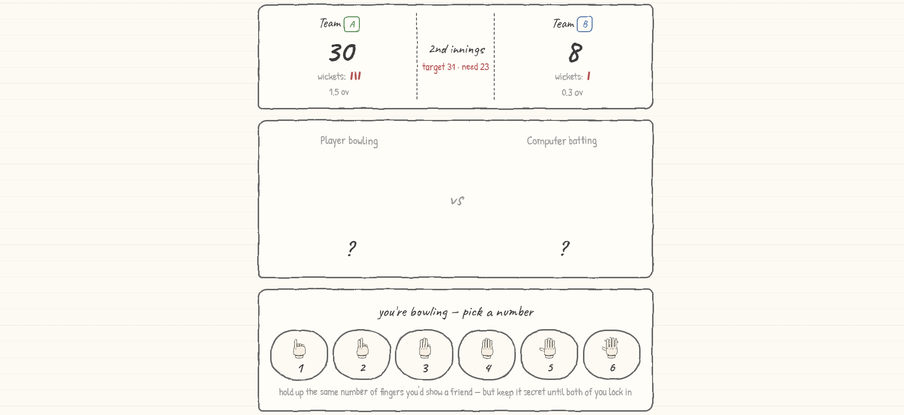
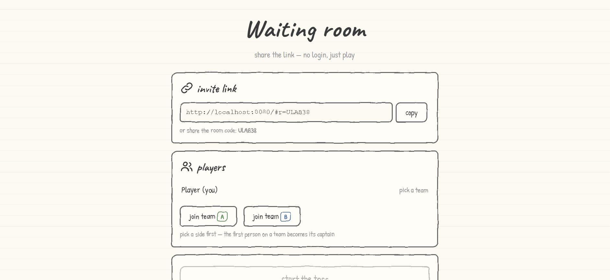

# Hand Cricket 

(*A online version of hand cricket made with pencil*)

The game support two mode :
- You vs The bot (yeh)
- Multiplayer mode where you can make team with your friend via invite link generated ingame.

(*If you dont know how to play this, then the game contain full in-game guide for you . yeh check that out.*)

(I hope you enjoy it !!yeh.)


## Quick playing:

Use [this](https://coderx838.github.io/HandCricket/)  demo link for playing the game.

Its fully working and you can also play with friend via invite like.


## Run locally:

what you need to run this locally (minimum requirements) is:
- A pc where you can run this (i know you have it, ig so)
- Git and Python installed (python is just for running server , game itself does not uses python.).

Then run following command in you local copy of repo , after cloning the repo ( i know you know how to do so.) :

```
python -m http.server 8080
```

Now you can access the game by opening ```http://localhost:8080``` in any browser.


## Screenshot :



(*This basically is the core game*)



(*This is where you create room and invite friends.!*)

-----------------------------------------------------------------------------------------------------------------------------------------


Made by a teen for [Hackclub ysws](https://crescent.hackclub.com/)